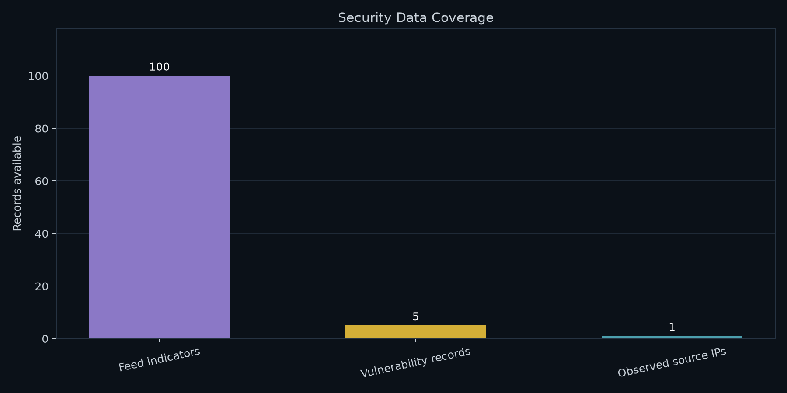
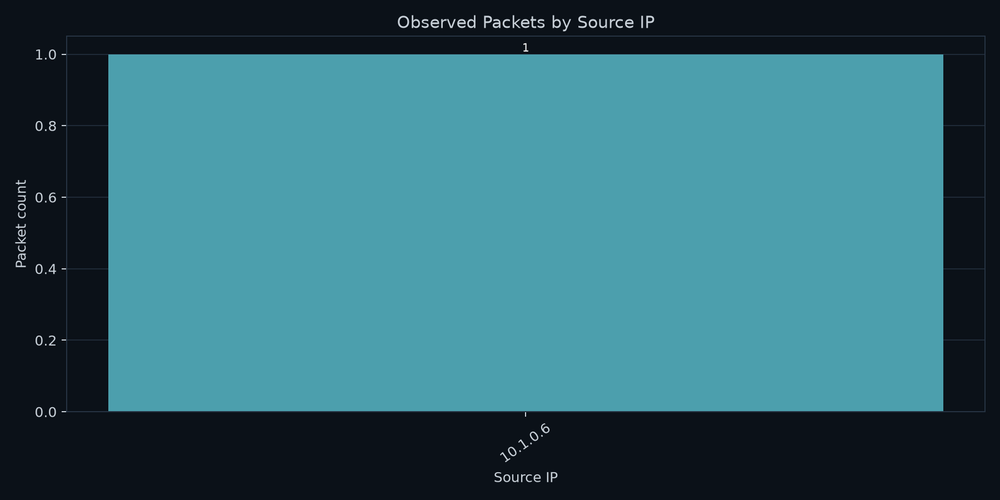
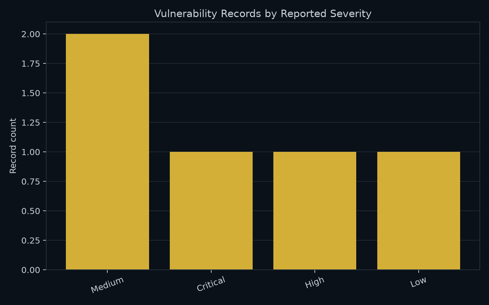

# Network Threat Intelligence Analysis

⚠️ **Automated Network Threat Intelligence, OSINT Correlation, and Risk Prioritization** ⚠️

This repository implements an **automated defensive threat-intelligence pipeline** designed to simulate how a SOC ingests, enriches, correlates, and prioritizes security data from multiple sources.

It focuses on **actionable intelligence**, not raw data.

---

## 🎯 Project Purpose & Scope

The primary objective of this project is to:

- Correlate **network activity**, **OSINT threat indicators**, and **vulnerability data**
- Identify **high-risk assets and behaviors**
- Produce **repeatable, automated intelligence reports**
- Demonstrate real-world **SOC and Blue Team workflows**

This is **not** a scanner or IDS replacement.  
It is an **intelligence aggregation and prioritization layer**.

---

## 🔄 Automation & Update Frequency

⏱️ **Update Frequency:**  
- Runs automatically via **GitHub Actions**
- Executes **multiple times per day** (scheduled and trigger-based)

Each execution:
- Regenerates intelligence datasets
- Recalculates risk prioritization
- Updates charts and summaries
- Rewrites the README snapshot section automatically

All timestamps are recorded in **UTC**.

---

## 📡 Intelligence Sources & Analysis Layers

### 🛰️ Open-Source Threat Intelligence (OSINT)
- Simulated high-confidence Indicators of Compromise (IOCs)
- Includes IPs, domains, URLs, and file hashes
- Ranked by **confidence score**
- Models curated threat feeds (CERTs, ISACs, vendor intelligence)

### 🔥 Vulnerability Risk Analysis
- Simulated vulnerability scan results
- CVEs prioritized using a calculated **risk score**
- Reflects exploitability and operational impact
- Mirrors remediation-driven SOC workflows

### 🌐 Network Traffic Analysis
- PCAP-derived network activity analysis
- Identifies **top source IPs by connection volume**
- Highlights anomalous or suspicious traffic patterns
- Visualized for rapid analyst triage

---

## 📊 Network Activity Visualization

🚨 **Top Source IPs by Connection Volume**

This chart highlights the most active source IPs observed in the analyzed traffic.  
Elevated activity may indicate:
- Reconnaissance or scanning behavior
- Misconfigured systems
- Potential malicious activity

---

<!-- AUTO-GENERATED-START -->

## Enterprise Security Intelligence Dashboard
**Last Updated (UTC):** 2026-10-16 16:42 UTC

> Feed indicators are not proof of compromise. Network matches below
> are exact source-IP matches only. Packet volume alone does not establish
> malicious behavior. Vulnerability records depend on the input dataset.

---

## Threat Intelligence Feed Indicators
**Source:** URLhaus and any other sources explicitly recorded in the feed.

| ioc_value                         | ioc_type   | confidence   | source   | date_added          | url_status   | threat           | urlhaus_reference                     |
|:----------------------------------|:-----------|:-------------|:---------|:--------------------|:-------------|:-----------------|:--------------------------------------|
| http://124.92.174.228:48261/i     | url        | N/A          | URLhaus  | 2026-10-16 16:32:09 | online       | malware_download | https://urlhaus.abuse.ch/url/3950965/ |
| http://125.44.18.57:42027/i       | url        | N/A          | URLhaus  | 2026-10-16 16:32:07 | online       | malware_download | https://urlhaus.abuse.ch/url/3950964/ |
| http://222.241.232.126:50704/i    | url        | N/A          | URLhaus  | 2026-10-16 16:25:20 | online       | malware_download | https://urlhaus.abuse.ch/url/3950963/ |
| http://103.87.194.109:43848/i     | url        | N/A          | URLhaus  | 2026-10-16 16:17:07 | online       | malware_download | https://urlhaus.abuse.ch/url/3950962/ |
| http://103.172.186.194:56184/i    | url        | N/A          | URLhaus  | 2026-10-16 16:02:06 | online       | malware_download | https://urlhaus.abuse.ch/url/3950961/ |
| http://171.104.126.3:51926/i      | url        | N/A          | URLhaus  | 2026-10-16 15:32:08 | online       | malware_download | https://urlhaus.abuse.ch/url/3950960/ |
| http://42.224.66.179:60764/i      | url        | N/A          | URLhaus  | 2026-10-16 15:32:07 | online       | malware_download | https://urlhaus.abuse.ch/url/3950959/ |
| https://kst.omsules.life/DvnX.zip | url        | N/A          | URLhaus  | 2026-10-16 15:27:20 | offline      | malware_download | https://urlhaus.abuse.ch/url/3950958/ |

---

## Vulnerability Records
**Note:** Verify whether the input is from an actual scanner or a sample dataset.

| vulnerability   | severity   |   severity_score |   risk_score |
|:----------------|:-----------|-----------------:|-------------:|
| CVE-2024-3011   | Critical   |                9 |          100 |
| CVE-2023-2198   | High       |                7 |           75 |
| CVE-2022-4421   | Medium     |                5 |           50 |
| CVE-2021-3375   | Low        |                3 |           25 |
| CVE-2020-1195   | Medium     |                5 |           50 |

---

## Security Data Coverage

---

## Observed Network Traffic
The chart reports packet counts from the network CSV. Gold bars indicate an
exact match between a source IP and an indicator explicitly typed as an IP.

---

## Vulnerability Records by Reported Severity

<!-- AUTO-GENERATED-END -->

